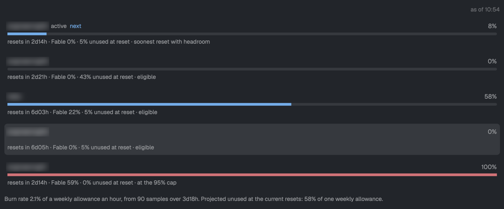

# ccusage

A panel of your Claude accounts' weekly plan use: each account's bar and reset, which one is active, which one `ccusage which` says to work on next and why, and how much of each weekly allowance `ccusage predict` projects will go unused. Everything it shows is ccusage's own answer, laid out natively.

## What you see

- The time ccusage answered (`as of 14:05`), in 17px dim text on the right. Herdr's tab or pane header carries the name, so the panel does not repeat it.
- When nothing is eligible, one line in the blocked color: `Nothing eligible; the soonest weekly reset is NAME's, in 2d04h`.
- One card per account, in `which`'s order: the chosen account first, then the eligible ones and those at the cap by rank, then the unknown ones by name. Each card is the account's name in semibold with its tags beside it (`active` in muted, `next` in the accent color), its weekly percent on the right, an 8px bar filled to that percent (accent; the blocked color at the cap; dim when unknown), and one 17px line: `resets in 3d04h · Fable 10% · 28% unused at reset · soonest reset with headroom`. An unknown account's line ends with `unknown:` and ccusage's reason, and a report's own error shows under it in the blocked color. When the reason is that error, the line ends with `unknown` alone, so it is said once.
- Under the cards, predict's line: `Burn rate 0.6% of a weekly allowance an hour, from 48 samples over 1d07h. Projected unused at the current resets: 97% of one weekly allowance.`, or `Too little history to project yet: ...`.
- It fills its block and scrolls, from a narrow column to a full pane; long lines truncate.
- Every size is a base size times `SCALE`, 1.5, set in one place in `main.js`: the text, the bars, the spacing, the corners and the card's dialog grow together, so the panel reads in a full tab. Its text is 18px, its dim lines 17px, and a dialog's title 21px.

## How it behaves

- It asks ccusage on a timer whose period is ccusage's usage cache lifetime, `LIFETIME` in `lifetime.js`, or longer when `props.every` (seconds) says so; never shorter. ccusage answers from its cache and fetches only what is older than that lifetime, so however many panels, TUIs and scripts are open, each account is fetched at most once a lifetime, and a rate-limited account waits out its cooldown for all of them.
- Countdowns tick from the clock once a minute and ask nothing.
- A click on a card opens a 960 x 780 dialog with that account's full `ccusage usage NAME --verbose` text in the terminal font, a `Use NAME` button and `Close`. `Use NAME` asks first, through Herdr's `confirm` dialog; confirmed, it runs `ccusage use NAME`, shows the line ccusage printed, and has every open panel ask ccusage again.
- Esc closes the dialog.

## Built from

- One mod, `ccusage`, with `"place": "none"`: it docks nowhere until opened: as a tab of its own with `ccusage herdr launch`, which runs `herdr-app do tab.new '{"name":"ccusage","mod":"ccusage"}'`, or as a pane with `herdr-app do pane.split '{"direction":"right","mod":"ccusage"}'`.
- It runs one program, `ccusage`: `which --json` and `predict --json` on its timer, `usage NAME --verbose` for a card's dialog, and `use NAME` when a switch is confirmed. It reaches no network itself and reads no file outside its folder.
- `exec`, `theme`, `props`, `settings`, `openOverlay` (itself as a dialog with `props.account`, and the shipped `confirm` with `command: { name: "ccusage.use" }`), `closeOverlay`, `nextCommand` (`use`, `refresh`) and `run("ccusage.refresh")`.
- `lifetime.js` is written by `ccusage herdr install` from ccusage's own cache lifetime, beside `main.js` and `mod.json`, which ccusage embeds when it is built.

## Watch out

- No rule runs here. The next marker, the ranks, the reasons and the projection are ccusage's; the panel only lays them out, so it cannot drift from the CLI.
- `which` exits 1 when nothing is eligible, with its JSON on stdout all the same; read stdout whatever the exit code.
- `nextCommand` carries a name and no arguments, so the dialog keeps the account it may switch to and acts on `use` only when it has one; every other open copy ignores it.
- Herdr keeps a hidden copy's timers running, so the period bounds those too.
- `h_flex` centers its children on the cross axis, so a child with no content takes no height unless given one: the bar's fill and the rest of its track take the track's height through `h_full()`. `herdr-app check` renders the mod once but shows nothing of its layout, so look at the pane.
- Install it with `ccusage herdr install`, which replaces only its own unedited copy and runs `herdr-app check`; an edited copy takes `--force`. Herdr runs the check as a background job, which can take a minute or two under load, so install says on stderr that it is waiting, and after five minutes it stops waiting and reports the mod as not checked, with the command to check it by hand. `ccusage herdr launch` then opens it as a tab of its own, or says why it could not: no Herdr home, the mod not installed, no `herdr-app` on `PATH`, or Herdr's own refusal.

## Done when

- `herdr-app check` passes on the installed folder.
- `ccusage herdr launch` opens it as a tab of its own.
- Opened as a tab or a pane, it shows each account's bar filled to its percent, and its reset, tags and reason as `ccusage which` gives them, and predict's line.
- A card's dialog shows the same text as `ccusage usage NAME --verbose`, and a confirmed `Use NAME` makes it active, as `ccusage which` then says.
